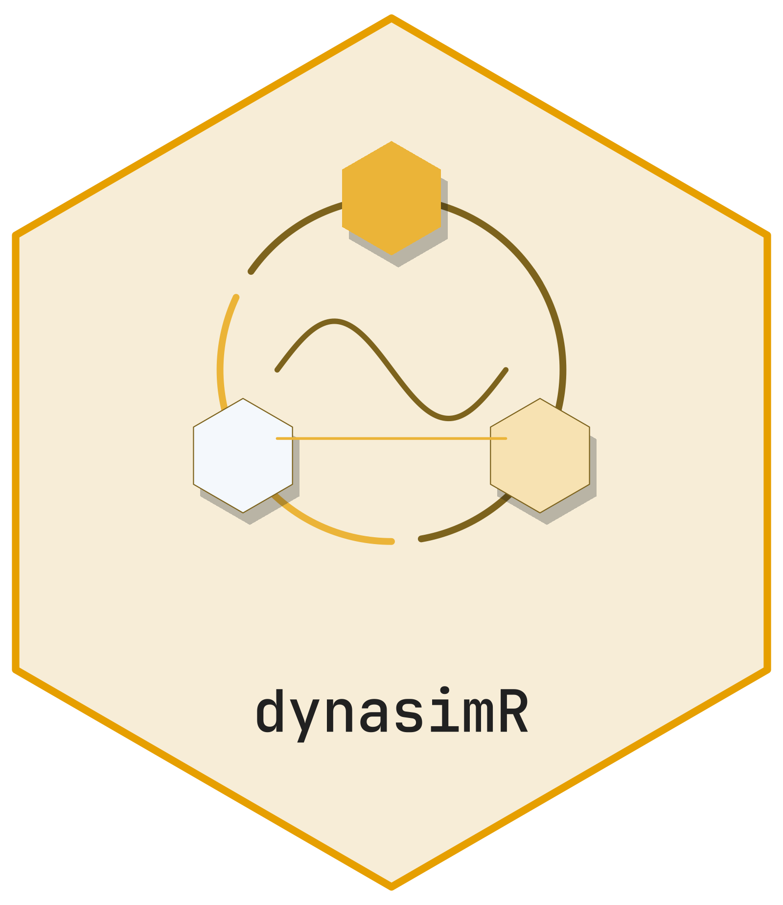

# dynasimR — Dynamic Agent-Node Simulation Analysis <picture class="cttir-readme-logo"><source class="cttir-logo-dark-source" media="(prefers-color-scheme: dark)" srcset="man/figures/logo-with-name-dark.png" /></picture>


<!-- badges: start -->
[](https://github.com/CTTIR/dynasimR/actions/workflows/R-CMD-check.yaml)
[](https://cttir.github.io/dynasimR/)
[](https://app.codecov.io/gh/CTTIR/dynasimR?branch=main)
[](https://opensource.org/licenses/MIT)
[](https://lifecycle.r-lib.org/articles/stages.html#experimental)
<!-- badges: end -->

A domain-neutral analysis and visualisation layer for discrete-event,
agent-based and node-actor simulation outputs. The package is
schema-harmonised: **Profile A** and **Profile B** share a loader and
use analysis functions appropriate to their recorded outcomes.

Typical use cases include any system in which entities (actors, nodes,
agents) move through states and interact within spatial or network
environments — for example flow analyses, state-transition studies,
resource allocation and policy comparisons.

The current version is an unreleased development candidate. CRAN and Zenodo
publication have not been confirmed; use the source repository for installation.

## Installation

```r
# Prerequisites for the complete quick start, including exports/dashboard:
install.packages(c("remotes", "xtable", "shiny", "shinydashboard",
                   "shinyWidgets", "plotly", "DT"))
remotes::install_github("cttir/dynasimR")
```

To install an unpublished local checkout instead, replace the last line with
`remotes::install_local("/path/to/dynasimR", dependencies = NA, upgrade = "never")`.
This installs required imports without upgrading existing dependencies.

SVG export uses R's Cairo graphics device. With macOS R builds linked to X11
(including CRAN binaries), install [XQuartz](https://www.xquartz.org/) and restart
R if its Cairo/X11 libraries are missing. `capabilities("cairo")` describes the
build and does not guarantee that these runtime libraries can load. Failed
exports report an error and preserve the previous output file.

## Quick start

```r
library(dynasimR)

# 1. Load bundled example data (or point to your own simulation outputs)
sim <- load_example_data()
# sim <- read_simulation("~/my-simulation/data/raw/")

# 2. Time-to-event analysis
km <- km_estimate(sim, endpoint = "stage2", stratify_by = "scenario")
plot_km(km, title = "Time-to-stage-2")

# 3. Policy effect (policy A vs. policy B)
pol <- policy_effect(sim, policy_a_scenario = "A-S08",
                     policy_b_scenario = "A-S07")
cat(pol$narrative)   # ready to drop into a report

# 4. Autonomy-level trade-off
al <- al_efficiency(sim, al_scenarios = c("0" = "A-S00", "1" = "A-S01"))
plot_al_tradeoff(al)

# 5. Manuscript export
export_latex_table(
  data     = pol$effect_sizes,
  filename = "policy_table.tex",
  caption  = "Policy effect sizes.",
  label    = "policy"
)

# 6. Interactive Shiny dashboard
launch_app()
```

## Feature map

| Analysis goal                         | Key function                  |
|---------------------------------------|-------------------------------|
| Entity flow through processing stages | `stage_throughput()`          |
| Time-to-event stratified by scenario  | `km_estimate()`, `cox_model()`|
| Policy A vs. policy B comparison      | `policy_effect()`             |
| Autonomy-level trade-off (AL0-AL5)    | `al_efficiency()`             |
| Compliance Index                      | `compute_compliance_index()`  |
| Profile B progress trajectory         | `progress_trajectory()`       |
| Profile B wait-gap index              | `compute_wait_gap_index()`    |
| Manuscript placeholder fill           | `fill_placeholders()`         |

## Requirements

- R >= 4.1.0 (base pipe `|>` used throughout)
- Required imports: dplyr, tidyr, purrr, readr, tibble, ggplot2,
  survival, rlang, cli, glue
- The dashboard requires `shiny`, `shinydashboard`, `shinyWidgets`, `plotly`,
  `DT` and `xtable`. `dynasimR::check_app_dependencies()` reports missing
  packages and prints an installation command; it does not install them.
- LaTeX table compilation needs `booktabs`; tables with notes also need
  `threeparttable`. For an ordinary article template, add
  `\providecommand{\botrule}{\bottomrule}` to the preamble (publisher templates
  may already define it). Figure export supports PDF, PNG and SVG. Typical manuscript
  widths are 88 mm for one column and 174 mm for two columns; check the target
  journal specifications.

## Data and interpretation

`read_simulation()` validates each scenario file before combining it. Keep
summary/entity scenario IDs consistent with their filenames and supply both
files for each scenario. A local `scenario_metadata.csv` is authoritative;
your own data never inherit assumptions from the bundled example scenarios.
See `?read_simulation` and `?validate_dynasimR_data` for the schema.

For Profile B, use `progress_trajectory()`, `compute_wait_gap_index()`,
`group_effect()` and `compute_completion_analysis()`. The dashboard supports
progress/completion overview, scenario comparison and summary-table export;
other dashboard analyses require Profile A. Separate mixed-profile directories
before launching the dashboard.

Policy differences and their intervals use **A minus B**, so a positive event
rate difference is an increase in events. Bootstrap comparisons resample runs
independently, not matched pairs. Entity-level survival/compliance intervals
assume independent entities and do not account for clustering by simulation
replication. Progress percentile bands describe the observed distribution;
they are not confidence intervals for an estimated median.

Survival analyses need observed event or censoring times and binary event
flags; invalid or missing inputs are rejected. Wait-gap calculations instead
need observed activation waits: encode entities not activated as `NA`. They
remain in the denominator and are not counted as timely activation.

Supply-demand ratios use `supply / demand`; zero-demand cells are undefined
(`NA`) and counted separately. The deprecated `eps` argument no longer changes
that ratio. The legacy `morris_screening()` function is a descriptive univariate
standardized-slope screen, not a replacement for a designed Morris trajectory experiment.

`plot_cost_effectiveness(..., show_ceac = TRUE)` retains its legacy argument
name but reports observed run fractions relative to fixed reference medians.
It does not estimate reference uncertainty or a cost-effectiveness acceptance
probability. Cost/outcome pairs must be complete; a zero effect difference has
an undefined (`NA`) incremental cost-effectiveness ratio.

Manuscript placeholders are literal values, never R expressions. By default,
`fill_placeholders()` preserves the source and existing output files. A template
requesting an unknown or unavailable result fails before writing; use `dry_run`
to inspect available substitutions. Exported table text is escaped as literal
LaTeX content, so embedded LaTeX commands are not interpreted.

## Development and validation

From a checkout, install package dependencies plus `pkgload`, `roxygen2` at the
version in `DESCRIPTION`, and `rcmdcheck`. TeX and Pandoc are needed for the full
manual/vignette check. The following scripts work from any directory:

```sh
Rscript /path/to/dynasimR/dev/dep_check.R
Rscript /path/to/dynasimR/dev/smoke_test.R
Rscript /path/to/dynasimR/dev/doc_and_check.R
```

The smoke script exercises both profiles and renders real export files. The
check script regenerates documentation without deleting unrelated files, builds
a source archive, and fails on errors, warnings or notes. See
[MAINTENANCE.md](MAINTENANCE.md) for the audit, validation evidence and remaining
release gates.

## License

MIT (c) R. Heller

## Citation

Cite the version or commit actually used and the repository URL, for example:

> Heller, R. (2026). *dynasimR: Analysis and visualisation of agent-based and discrete-event simulation output* (Version 0.2.0) [Computer software]. https://github.com/CTTIR/dynasimR

The earlier draft metadata named DOI `10.5281/zenodo.21889932`. It is retained
in the maintenance record for provenance; the public Zenodo and DataCite APIs
returned no published record during this audit. Confirm publication before
using that DOI in a manuscript.

## Use of LLM tools

Where applicable, LLM tools were used for narrowly defined, non-authorial tasks:
copyediting, prose refinement, Markdown/LaTeX formatting, boilerplate scaffolding
(such as CI configurations and build scripts), and code refactoring. Tools included
[Chat AI](https://kisski.gwdg.de/leistungen/2-02-llm-service/), the KISSKI
(GWDG) service, and self-hosted **Mistral Small (24B, Apache-2.0)** served through
a local **vLLM architecture** on an Ubuntu Linux workstation with Intel
processors and NVIDIA GPUs. Self-hosted use also includes models that were
further trained (fine-tuned) or weight-edited in-house for specific tasks.
All self-hosted models ran locally, with no data sent to third parties.

All scientific claims, methodological choices, analyses, interpretations and
conclusions remain the authors' own. Where applicable, LLM-generated material
must be reviewed and revised before inclusion, and references must be verified
against their DOI, arXiv ID or ISBN.

Local software setup: vLLM with Python/PyTorch, plus R and RStudio.

## Branding

Editable R artwork and regeneration instructions are in [tools/branding](https://github.com/CTTIR/dynasimR/blob/main/tools/branding/README.md).
