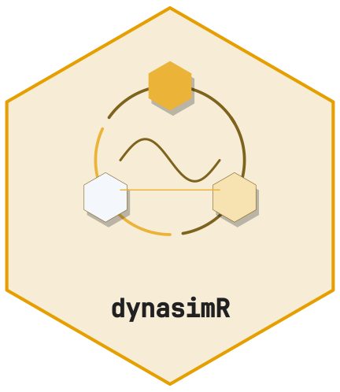
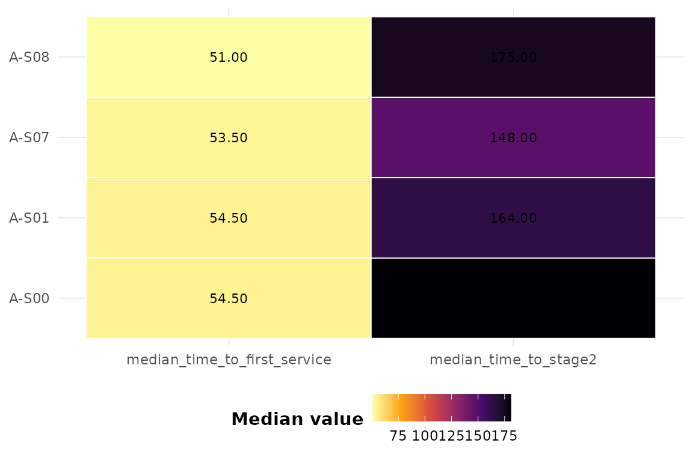

# Entity flow analysis



[](https://github.com/CTTIR/dynasimR/actions/workflows/R-CMD-check.yaml)
[](https://cttir.github.io/dynasimR/)
[](https://app.codecov.io/gh/CTTIR/dynasimR?branch=main)
[](https://opensource.org/licenses/MIT)
[](https://lifecycle.r-lib.org/articles/stages.html#experimental)

Many simulations move entities through sequential processing stages
(Stage 1 -\> Stage 2 -\> Stage 3 -\> Stage 4). This vignette shows how
to quantify throughput and identify bottlenecks.

``` r

library(dynasimR)
sim <- load_example_data()
```

## Stage throughput

``` r

st <- stage_throughput(sim)
st
#> # A tibble: 4 × 7
#>   scenario stage      n median_time   q25   q75 completed_frac
#>   <chr>    <chr>  <int>       <dbl> <dbl> <dbl>          <dbl>
#> 1 A-S00    Stage2  4000         153    77  258           0.735
#> 2 A-S01    Stage2  4000         145    74  253           0.746
#> 3 A-S07    Stage2  4000         151    80  259           0.744
#> 4 A-S08    Stage2  4000         151    77  259.          0.782
```

Only `Stage2` (time_to_stage2) is present in the shipped example, but
the machinery generalises to Stage1..Stage4 when the columns exist in
your simulation output.

## Bottleneck detection

``` r

detect_bottlenecks(st, threshold = 0.75)
#> # A tibble: 1 × 8
#>   scenario stage      n median_time   q25   q75 completed_frac is_bottleneck
#>   <chr>    <chr>  <int>       <dbl> <dbl> <dbl>          <dbl> <lgl>        
#> 1 A-S00    Stage2  4000         153    77   258          0.735 TRUE
```

## Visualising first-service times

``` r

plot_scenario_heatmap(
  sim,
  metrics = c("median_time_to_first_service",
              "median_time_to_stage2")
)
```


