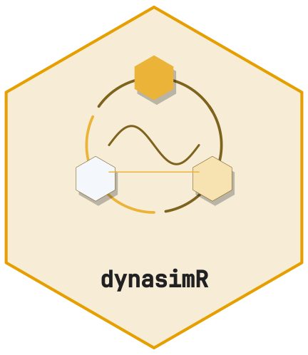
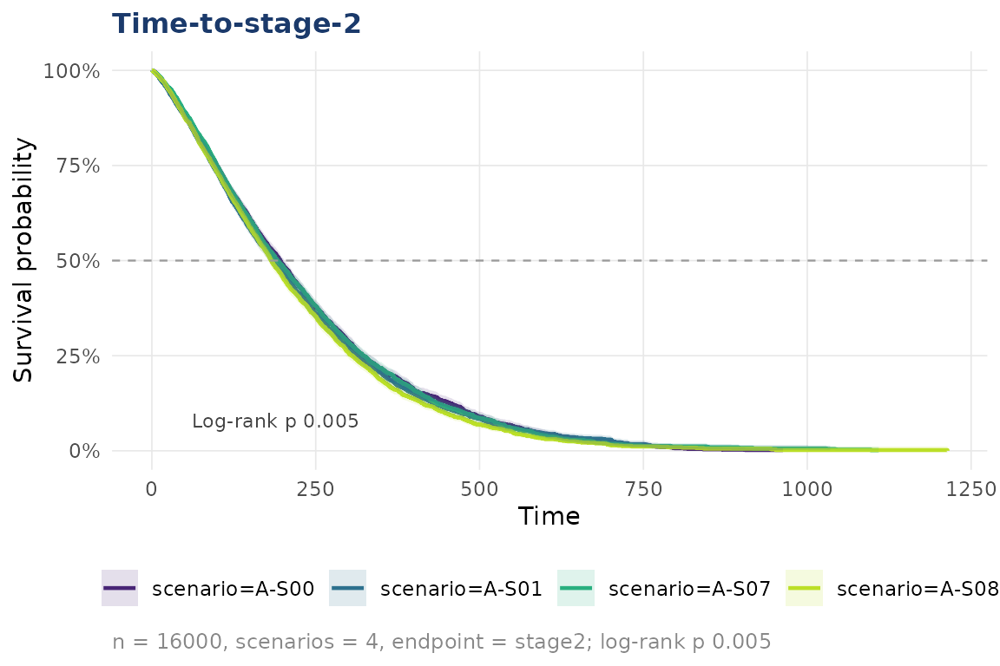
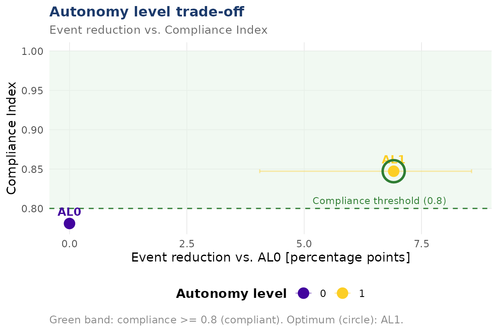

# Getting started with dynasimR



[](https://github.com/CTTIR/dynasimR/actions/workflows/R-CMD-check.yaml)
[](https://cttir.github.io/dynasimR/)
[](https://app.codecov.io/gh/CTTIR/dynasimR?branch=main)
[](https://opensource.org/licenses/MIT)
[](https://lifecycle.r-lib.org/articles/stages.html#experimental)

``` r

library(dynasimR)
```

## Load data

``` r

sim <- load_example_data()
print(sim)
#> 
#> ── dynasimR_data ───────────────────────────────────────────────────────────────
#> • Scenarios: 4
#> • Profile: "Profile_A"
#> • Summary rows: 200
#> • Entity events: 16000
#> • Loaded: "2026-11-10 09:03"
#> • Path: /home/runner/work/_temp/Library/dynasimR/extdata
```

## Time-to-event analysis

``` r

km <- km_estimate(sim, endpoint = "stage2",
                  stratify_by = "scenario")
plot_km(km, title = "Time-to-stage-2")
```



## Policy effect

``` r

pol <- policy_effect(sim,
  policy_a_scenario = "A-S08",
  policy_b_scenario = "A-S07",
  n_bootstrap       = 200)
cat(pol$narrative)
#> The policy A-minus-B event-rate difference (scenario A-S08 vs. A-S07) was -7.4 percentage points (95% CI: -9 to -5.6); the event rate was lower under policy A (Wilcoxon test: W = 215, adjusted p < 0.001). The Compliance Index was higher under policy A (0.919 vs. 0.658).
```

## Autonomy trade-off

Only two AL points are present in the shipped example data, but the
machinery is the same for a full AL sweep.

``` r

al <- al_efficiency(
  sim,
  al_scenarios         = c("0" = "A-S00", "1" = "A-S01"),
  compliance_threshold = 0.80,
  n_bootstrap          = 200
)
plot_al_tradeoff(al)
```



## Manuscript-ready export

``` r

export_latex_table(
  data     = pol$effect_sizes,
  filename = "policy_table.tex",
  caption  = "Policy effect sizes.",
  label    = "policy"
)
```

## Launching the dashboard

``` r

launch_app()                                        # example data
launch_app(data_dir = "~/my-simulation/data/raw")
```
