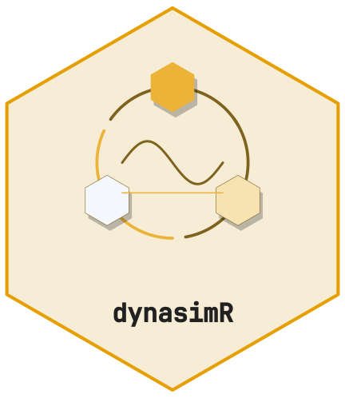
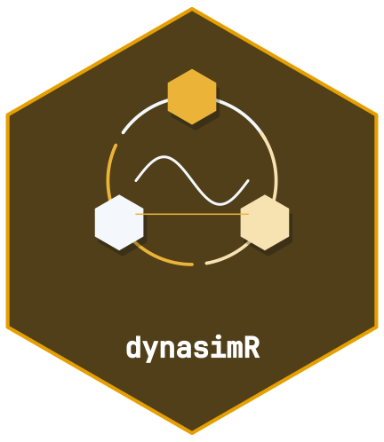

<!-- cttir-vignette-logo: start -->
<style>
.cttir-vignette-logo { float: right; width: 120px; max-width: 30%; margin: 0 0 1rem 1.5rem; }
.cttir-vignette-logo img { width: 100%; height: auto; border: 0; background: transparent; box-shadow: none; }
.cttir-vignette-logo .cttir-vignette-logo-light { display: block; }
.cttir-vignette-logo .cttir-vignette-logo-dark { display: none; }
@media (prefers-color-scheme: dark) {
  .cttir-vignette-logo .cttir-vignette-logo-light { display: none; }
  .cttir-vignette-logo .cttir-vignette-logo-dark { display: block; }
}
[data-bs-theme="light"] .cttir-vignette-logo .cttir-vignette-logo-light { display: block; }
[data-bs-theme="light"] .cttir-vignette-logo .cttir-vignette-logo-dark { display: none; }
[data-bs-theme="dark"] .cttir-vignette-logo .cttir-vignette-logo-light { display: none; }
[data-bs-theme="dark"] .cttir-vignette-logo .cttir-vignette-logo-dark { display: block; }
</style>
<div class="cttir-vignette-logo">
  
  
</div>
<!-- cttir-vignette-logo: end -->

<!-- badges: start -->
[](https://github.com/CTTIR/dynasimR/actions/workflows/R-CMD-check.yaml)
[](https://cttir.github.io/dynasimR/)
[](https://CRAN.R-project.org/package=dynasimR)
[](https://app.codecov.io/gh/CTTIR/dynasimR?branch=main)
[](https://cran.r-project.org/package=dynasimR)
[](https://cran.r-project.org/package=dynasimR)
[](https://opensource.org/licenses/MIT)
[](https://lifecycle.r-lib.org/articles/stages.html#experimental)
<!-- badges: end -->

```{r setup, include = FALSE}
knitr::opts_chunk$set(
  collapse = TRUE,
  comment  = "#>",
  fig.width = 6, fig.height = 4
)
```

```{r}
library(dynasimR)
```

## Load data

```{r}
sim <- load_example_data()
print(sim)
```

## Time-to-event analysis

```{r}
km <- km_estimate(sim, endpoint = "stage2",
                  stratify_by = "scenario")
plot_km(km, title = "Time-to-stage-2")
```

## Policy effect

```{r}
pol <- policy_effect(sim,
  policy_a_scenario = "A-S08",
  policy_b_scenario = "A-S07",
  n_bootstrap       = 200)
cat(pol$narrative)
```

## Autonomy trade-off

Only two AL points are present in the shipped example data, but the
machinery is the same for a full AL sweep.

```{r}
al <- al_efficiency(
  sim,
  al_scenarios         = c("0" = "A-S00", "1" = "A-S01"),
  compliance_threshold = 0.80,
  n_bootstrap          = 200
)
plot_al_tradeoff(al)
```

## Manuscript-ready export

```{r, eval = FALSE}
export_latex_table(
  data     = pol$effect_sizes,
  filename = "policy_table.tex",
  caption  = "Policy effect sizes.",
  label    = "policy"
)
```

## Launching the dashboard

```{r, eval = FALSE}
launch_app()                                        # example data
launch_app(data_dir = "~/my-simulation/data/raw")
```
