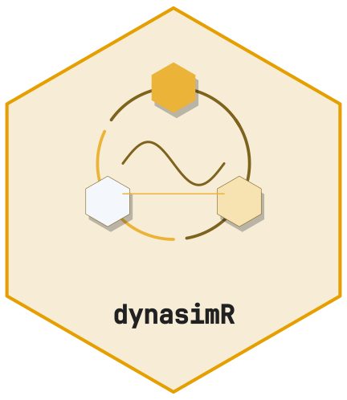

<!-- cttir-vignette-logo: start -->
<style>
.cttir-vignette-logo { float: right; width: 120px; max-width: 30%; margin: 0 0 1rem 1.5rem; }
.cttir-vignette-logo img { width: 100%; height: auto; border: 0; background: transparent; box-shadow: none; }
.cttir-vignette-logo .cttir-vignette-logo-light { display: block; }
.cttir-vignette-logo .cttir-vignette-logo-dark { display: none; }
@media (prefers-color-scheme: dark) {
  .cttir-vignette-logo .cttir-vignette-logo-light { display: none; }
  .cttir-vignette-logo .cttir-vignette-logo-dark { display: block; }
}
[data-bs-theme="light"] .cttir-vignette-logo .cttir-vignette-logo-light { display: block; }
[data-bs-theme="light"] .cttir-vignette-logo .cttir-vignette-logo-dark { display: none; }
[data-bs-theme="dark"] .cttir-vignette-logo .cttir-vignette-logo-light { display: none; }
[data-bs-theme="dark"] .cttir-vignette-logo .cttir-vignette-logo-dark { display: block; }
</style>
<div class="cttir-vignette-logo">
  
  
</div>
<!-- cttir-vignette-logo: end -->

<!-- badges: start -->
[](https://github.com/CTTIR/dynasimR/actions/workflows/R-CMD-check.yaml)
[](https://cttir.github.io/dynasimR/)
[](https://app.codecov.io/gh/CTTIR/dynasimR?branch=main)
[](https://opensource.org/licenses/MIT)
[](https://lifecycle.r-lib.org/articles/stages.html#experimental)
<!-- badges: end -->

```{r setup, include = FALSE}
knitr::opts_chunk$set(collapse = TRUE, comment = "#>",
                      eval = FALSE)
```

This vignette shows how to get from raw simulation output to a
publication-quality document with automatically filled `[XX_*]`
placeholders.

## 1. LaTeX tables

```{r}
library(dynasimR)
sim <- load_example_data()
pol <- policy_effect(sim,
  policy_a_scenario = "A-S08",
  policy_b_scenario = "A-S07")

export_latex_table(
  data     = pol$effect_sizes,
  filename = "table_policy.tex",
  caption  = "Policy effect sizes (Cohen's d and risk difference).",
  label    = "policy",
  note     = "n = 50 replications per scenario."
)
```

The generated `.tex` uses `booktabs` rules and treats captions, notes and
character cells as literal text, escaping LaTeX metacharacters once. Load
`\usepackage{booktabs}` in the document preamble and, for tables with notes,
`\usepackage{threeparttable}`. The publisher-compatible bottom rule is
`\botrule`; if your template does not define it, add
`\providecommand{\botrule}{\bottomrule}` to the preamble.

## 2. Figures at publication dimensions

```{r}
km <- km_estimate(sim, endpoint = "stage2")
export_figure(
  plot      = plot_km(km),
  filename  = "figure_km.pdf",
  width_mm  = 174,          # double column (88 mm for a single column)
  height_mm = 110
)
```

SVG output requires working Cairo runtime libraries. Some macOS R builds,
including CRAN binaries, need [XQuartz](https://www.xquartz.org/); restart R after
installing it. A positive `capabilities("cairo")` alone does not prove that the
libraries can load. `export_figure()` checks staged output before replacing a
previous file and reporting success. See the
[R graphics-device documentation](https://stat.ethz.ch/R-manual/R-devel/library/grDevices/html/cairo.html).

## 3. Placeholder substitution in the .tex body

Given a source `manuscript.tex` with placeholders like
`[XX_POLICY_DELTA_EVENT]`, substitute them in one call:

```{r}
reps <- fill_placeholders(
  sim_data          = sim,
  tex_file          = "manuscript.tex",
  output_file       = "manuscript_filled.tex",
  policy_a_scenario = "A-S08",
  policy_b_scenario = "A-S07",
  baseline_scenario = "A-S00"
)
reps          # named character vector of substitutions performed
```

The policy delta and its bounds are signed **A minus B**, in percentage points.
The source file is preserved. Existing output files require `overwrite = TRUE`;
unknown or unavailable requested results cause an error before any file is
written. `dry_run = TRUE` returns the substitution map without writing.
For extensionless staging paths, use `export_figure(..., format = "pdf")`
(or `"png"` / `"svg"`).

## Complete placeholder list

| Placeholder | Source |
|---|---|
| `[XX_POLICY_DELTA_EVENT]` | `policy_effect()` |
| `[XX_POLICY_DELTA_CI_LO]` | `policy_effect()` |
| `[XX_POLICY_DELTA_CI_HI]` | `policy_effect()` |
| `[XX_COMPLIANCE_A]` | `compute_compliance_index()` |
| `[XX_COMPLIANCE_B]` | `compute_compliance_index()` |
| `[XX_OPTIMAL_AL]` | `al_efficiency()` |
| `[XX_EVENT_BASELINE]` | median event rate at baseline scenario |
| `[XX_EVENT_BEST]` | min median event rate across all scenarios |
